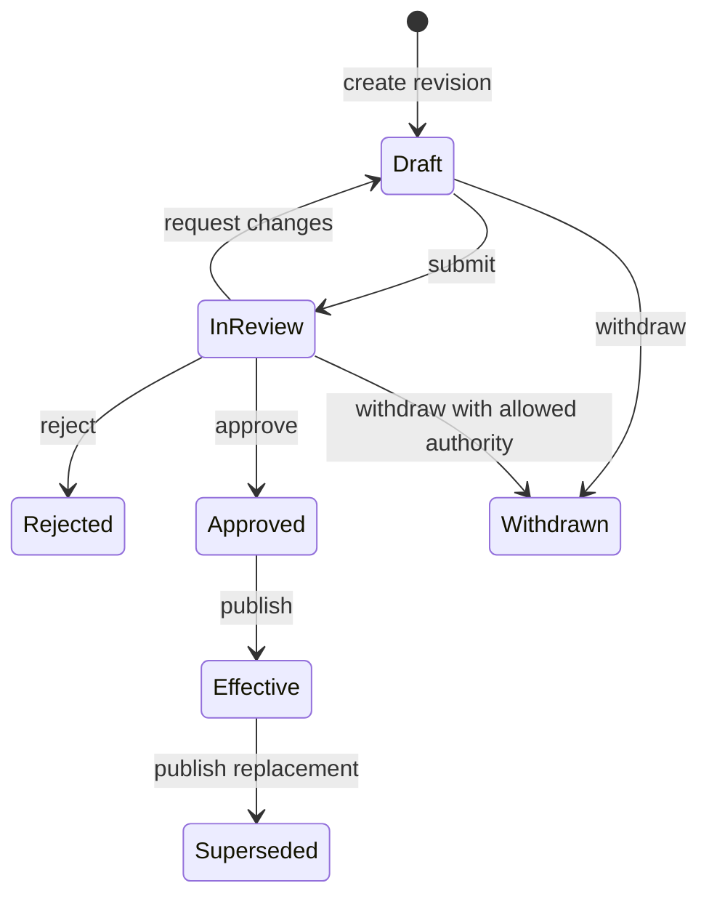

# Controlled-document governance lifecycle

**Status:** accepted engineering design; runtime lifecycle writes remain gated. This document assigns no staff member or role a governance grant and does not approve any SOP.

## Purpose and current boundary

The staff library currently lists and downloads only current, site-scoped, clean-scanned effective revisions. Its runtime metadata access is read-only. The lifecycle design extends the existing revision model when the owner supplies the controlled SOP library/register and resolves the governance choices in `REV-041`.

The lifecycle must preserve the current effective-only library contract. Drafts, revisions under review, rejected submissions, withdrawn proposals, expired or superseded copies, and records with unknown approval history never appear as current procedures or satisfy a work or safety requirement. No procedures are derived from the `after-sales` reference or synthesized as operational content.

## Selected structure

Use the existing site-scoped document and revision records as the authoritative aggregate. Add named, command-specific transitions through `runStaffCommand`; do not add a second event-sourced case ledger or generic status-update route. The command boundary already provides scope and membership rechecks, command receipts, locking, append-only audit events and atomic mutation/outbox persistence. Document-specific authorization, evidence acceptance, transition rules and publication invariants remain owned by the controlled-document domain.

Every write takes a command ID and expected document/revision version. The server derives the actor and organisation/site from the authenticated staff session. It rechecks the dedicated action grant and current evidence state inside the transaction. The caller cannot send an actor, role, grant, approval state, effective result or trusted scope.

## Proposed transition model



`Rejected` and `Withdrawn` are distinct terminal outcomes; neither is mislabeled `Superseded`. `Superseded` means an effective revision was replaced. Existing migration 041 does not store rejected or withdrawn states, so implementation requires a reviewed forward migration and read-path compatibility check before any such transition is enabled.

Review outcome is explicit: `accept`, `request-changes`, or `reject`. Review is not approval. Approval and publication are separate named actions. Whether they must be different actors, whether approval can publish, who may withdraw, and which states are allowed to be withdrawn remain policy decisions. Commands fail closed while the applicable approved policy or grant is absent.

## Domain interface sketch

This is a design contract, not an implemented API.

```ts
type DocumentAction =
  | "document.author"
  | "document.review"
  | "document.approve"
  | "document.publish"
  | "document.withdraw"
  | "document.acknowledge";

type ReviewOutcome = "accept" | "request-changes" | "reject";

interface ControlledDocumentGovernance {
  createDraft(scope: AuthenticatedSiteScope, input: CreateDraft): Promise<RevisionView>;
  reviseDraft(scope: AuthenticatedSiteScope, input: ReviseDraft): Promise<RevisionView>;
  submitForReview(scope: AuthenticatedSiteScope, input: RevisionCommand): Promise<RevisionView>;
  recordReview(scope: AuthenticatedSiteScope, input: ReviewDecision & { outcome: ReviewOutcome }): Promise<RevisionView>;
  approve(scope: AuthenticatedSiteScope, input: ApprovalDecision): Promise<RevisionView>;
  publish(scope: AuthenticatedSiteScope, input: PublishRevision): Promise<RevisionView>;
  withdraw(scope: AuthenticatedSiteScope, input: WithdrawRevision): Promise<RevisionView>;
  recordAcknowledgement(scope: AuthenticatedSiteScope, input: AcknowledgeRevision): Promise<AcknowledgementView>;
}
```

All command inputs include `commandId` and the last observed aggregate version. They exclude actor, organisation, site, role, grant and lifecycle status. The domain resolves a current signed action grant at write time and stores an immutable decision snapshot containing the acting staff ID, grant ID/revision, policy revision, timestamp, decision, rationale and accepted evidence references. Grant snapshots preserve the basis of past decisions; revocation prevents future actions and does not rewrite history.

No policy enum or distribution/acknowledgement default is encoded until management approves it. A missing applicable policy, missing grant, unknown historical approval, unaccepted evidence, dirty/stale scan result, wrong-site reference or stale aggregate version is a denial or conflict with no partial mutation.

## Transition requirements

| Command | Result | Server checks |
| --- | --- | --- |
| `createDraft` | New draft revision | Active site scope, author grant, registered document identity, unique revision identity, accepted source evidence |
| `reviseDraft` | Updated draft version | Author grant, draft state, expected version; preserve prior decision/audit records |
| `submitForReview` | Draft becomes under review | Complete approved metadata schema, accepted clean evidence, submission grant, applicable governance policy |
| `recordReview` | Review accepted, returned for changes, or rejected | Reviewer grant; reason for changes/rejection; actor-separation rule from approved policy |
| `approve` | Reviewed revision becomes approved | Approver grant, valid review outcome, accepted decision evidence, policy and separation checks |
| `publish` | Approved revision becomes effective | Publisher grant, valid effective interval, accepted evidence rechecked; atomically close predecessor and publish successor under the document lock |
| `withdraw` | Draft/in-review revision becomes withdrawn | Explicitly approved withdrawal authority and allowed state; reason; no deletion of evidence/history |
| `recordAcknowledgement` | Append a staff acknowledgement record | Approved policy requires acknowledgement; eligible staff/revision, current scope and immutable revision hash |

The final catalog and generic procedure download continue to use the same strict predicate: matching organisation/site, effective time window, approved distribution, linked procedure evidence, accepted clean scan, and unchanged accepted object hash. Publication updates the revision rows, decision snapshot, audit event, idempotency receipt and outbox item in one transaction. Replays return the original receipt. Concurrent publications serialize on the document root; only one revision may be effective at a time.

Acknowledgement records show only that a staff member acknowledged a specific revision at a specific time. They do not establish competence, training, authorization, or successful performance.

## Module ownership and access

- `controlled-documents.ts` owns revision transitions, approved-policy resolution, grant checks, evidence rules and the effective-revision predicate shared by list/download.
- `commands.runStaffCommand` owns shared transaction, receipt, locking, audit and outbox mechanics. Do not duplicate those mechanics in a workflow service.
- The evidence service owns upload acceptance and clean-scan facts. A document command must verify purpose, target, site, accepted hash and current scan result.
- HTTP routes parse named actions and call the domain module. There is no route that accepts a lifecycle status or arbitrary revision metadata.
- Staff catalog access remains effective-only. Draft and review screens, metadata visibility, comments, distribution, acknowledgements and notifications are not implemented until their access rules are approved.
- The VMMS Operator keeps account-administration duties. The Head of Service Centre keeps operations and workforce duties. Neither role gains document authority by title or by general write access.

## Owner inputs that gate implementation

1. The owner supplies the actual SOP files and controlled-document register, including document identity, revision, source approval, effective/superseded dates, applicability, owner and review interval.
2. Management identifies who may author, review, approve, publish, withdraw and verify procedures, and approves any required separation of duties. No named people or roles are assigned by this design.
3. Management approves distribution classes, draft/review visibility, review deadlines, acknowledgement scope, retention/correction rules, emergency withdrawal and who may repair mistakes.
4. The authority owner provisions the exact signed grants and their scope after the permission profile is approved; no runtime role can create its own grants.
5. Reconcile actual source fields and aliases to the schema, including whether procedure files and approval evidence need distinct evidence purposes.

Track these decisions under `REV-041`, receipt and inventory under `O-001`, and field/revision reconciliation under `O-002`. Until the required inputs and grants are approved, there are no lifecycle write routes, governance UI, operational document imports or effective synthetic SOPs.

## Implementation and verification sequence after approval

1. Reconcile the owner-supplied register and approved policy to the type/state model; update review decisions and migration plan.
2. Write the forward migration for rejected/withdrawn history and any decision/acknowledgement snapshots, with tenant/site constraints and runtime grants reviewed against the actual database role.
3. Implement pure transition validation and command-specific authorization; keep site scope, grant, evidence, idempotency and version checks inside the command transaction.
4. Prove PostgreSQL replay, wrong-site denial, missing/revoked-grant denial, accepted/dirty evidence, stale version, rollback and concurrent replacement publication.
5. Add governance UI only after access rules are approved; test with synthetic fixtures and real staff UAT separately.

The current list/download implementation is verified independently; its evidence does not count as verification of this future write lifecycle or operational SOP approval.
