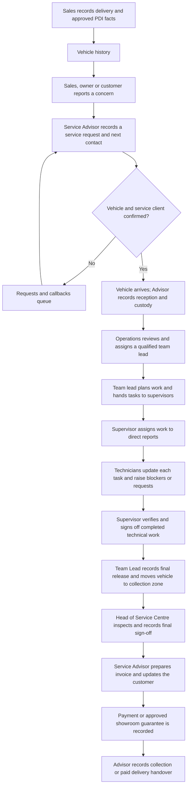

# Raymond Gray after-sales service journey

Status: proposed end-to-end workflow based on the owner's directions. This document joins the existing lifecycle and business rules into one operator view. It does not grant technical, inspection, release, financial or document-control authority. Open decisions remain in the [review register](../decisions/review-register.md).

## One vehicle history, one job per visit

Keep one canonical vehicle record and a dated history. Sales delivery, PDI, service requests, workshop visits, work orders, tasks, inspections, invoices and collection records link to that vehicle by stable IDs. Keep the source and certainty of each fact visible. A purchaser at delivery is not automatically the current owner, service client or payer.

For each service visit, keep these people/organizations distinct and explicitly selected:

- **Service client:** the person or organization responsible for paying or guaranteeing payment.
- **Vehicle owner:** the verified owner, or a source-reported owner until verification is recorded.
- **Visit contact:** the caller, driver or representative handling this visit.
- **Staff:** the named person acting in the system, tied to their current site membership and role placement.

A name, email, phone number, VIN or registration match must never create or merge these relationships automatically.

## End-to-end flow

The owner clarified the order on 13 November 2026: the Supervisor records technical completion; the Team Lead records final release and places the vehicle in the collection zone; the Head of Service Centre then inspects and records the required sign-off; only after that may the Service Advisor update the customer. The Advisor also checks cleanliness, prepares and verifies the invoice, records payment or an approved showroom guarantee, then completes collection or paid delivery. This sequence is resolved under `REV-046`; the commands remain unavailable until the signed authority schedule, applicable SOPs, evidence rules and commercial policies are approved.

## What the current application supports

- Staff sign-in, site-scoped role access, site-aware session data and saved intake drafts.
- The role-aware Today page shows the current user's visible overdue and due-today callbacks from the existing request filters. It shows a short action, concern, reported vehicle and site-local due time, then links to the original request with its filter preserved; callback updates remain in Requests.
- Vehicle reception intake with a selected paying client, separately reported owner and visit contact, vehicle details, complaints, warranty-at-entry, odometer, battery charge and custody facts.
- One work order per visit, additional complaints, proposed work tasks, diagnostic observations, Operations review, qualified team-lead assignment, team planning and supervisor handoff/allocation.
- Sales delivery and PDI observations are recorded with source provenance and linked into same-site vehicle history. One initial delivery per site/vehicle is enforced, and the Sales screen selects an existing delivery before adding PDI notes. Sales/PDI history remains limited to Head of Service Centre, Sales Representative and PDI Observer; sales workbook rows remain staged until owner review. A separate audited Service History screen is available to active Head, Service Advisor, Team Lead, Supervisor and Technician/Engineer/Trainee roles. It shows site-local complaints and attributed work entries while excluding delivery purchaser claims, owner and payer details. See `REV-049` and `docs/verification/service-history-2026-11-20.md`.
- Service requests capture caller details and callbacks, can be linked to a confirmed job, and retain contact/status history. The work-order page now gives the Head of Service Centre and Service Advisor a recent-contact view and a direct route back to that canonical request record; it records contact history only and does not send a message or represent a technical sign-off.
- The work-order current-step card links directly to the matching Operations review, Team Lead assignment/work plan, Supervisor handover, or task assignment section. It scrolls and moves keyboard focus to the target heading; it does not bypass server permissions. See [next-action navigation verification](../verification/work-order-next-action-navigation-2026-11-20.md).
- Assigned workers can acknowledge tasks and record progress, blockers, comments or requests. The current Supervisor can read a paginated, audited, read-only feed for active direct reports on the handed-off plan; none of these entries authorises work or signs off a repair.
- Assigned workers can also append findings, tests, actions and follow-ups against their current task. Entries retain correction history, evidence labels, actor and time. A purpose-built, paginated service report presents those entries as recorded claims; it does not authorize work or imply G2 approval, technical completion, release, payment or customer contact. The current action-entry command still lacks the specific technical authority and effective G2 checks required before staff use it for live repair work.
- Work-order evidence handling, controlled staff documents, site work queues, staff messages and purpose-built work-order/Head reports.

The work-order report is selectable text with a separate print layout. It shows visit facts and attributed task work history, paginates the entry set, and reports accepted evidence by safe file name and media type. It is not a signed completion certificate or a complete customer/finance handover report. The [service work-history and report contract](service-work-history-and-reports.md) records its scope and limits.

The service reception form is for a vehicle arriving at the workshop. It is not an inbound phone-call form. Planned work and supervisor allocation are not technician completion. No report may present an action as approved, signed off, released, invoiced or paid merely because its narrative says it happened.

## Work that remains to build

- Correction/review workflows for imported sales and delivery facts, the approved backlog importer, and staff acceptance of the sales-to-service data.
- Supervisor technical sign-off, Team Lead release, the Head's final inspection/review, advisor customer updates, invoice review, payment/guarantee, collection and delivery as separately authorized steps.
- Current G2 technical authorization and dispatch checks for the exact approved task scope, source procedure, required evidence, actor grants and model/system/task qualification. Findings, tests and actions must remain unavailable for live execution until their own consent and repair gates pass.
- Supervisor technical completion, Team Lead release, the Head's final inspection/review, advisor customer updates, invoice review, payment/guarantee, collection and delivery as separately authorized steps.
- Continue simplifying the role-aware screen path: the current step now has direct section navigation, while due-time policy, complete role UAT, manual assistive-technology checks, and later sign-off/handover flows remain open. Keep staff/team/document/report administration in secondary navigation. On dense screens, independently scrolling job sections are allowed; do not let sidebars or actions disappear at narrow widths.

The [service request and callback contract](service-requests-and-callbacks.md) defines the request record, follow-up queue and conversion to reception. Task and verification IDs are linked from this page's [implementation tracker](../delivery/implementation-tracker.md). Existing safety and commercial tasks remain the authority for their respective controls.

## Screen model

Keep the existing Raymond Gray branding and workshop imagery. Use a short primary staff path:

1. **Today**: role-specific assigned work, requests needing contact and overdue callbacks.
2. **Requests**: new enquiries, confirmation gaps and follow-ups.
3. **Jobs**: workshop queue and the full job timeline.
4. **Vehicles**: separate Sales and PDI History and Service History screens, each with its own role boundary and data scope.

Team, procedures, reports and account administration stay in role-aware secondary areas. A user should not need to open several separate workspaces to understand who owns a job or what must happen next. This is an information-architecture proposal; it does not authorize a new visual direction.

## Release conditions

1. Add approved role permissions and signed server grants for each transition; titles alone do not authorize it.
2. Load the owner-provided SOPs and authority schedule. Until then, G1 through G5 remain fail-closed where their prerequisites are unknown.
3. Implement the accepted `REV-046` transition order only after the signed authority schedule, SOPs, evidence rules and commercial policies are approved.
4. Verify the full journey with real PostgreSQL, a browser for each role, denied transitions, stale/replayed commands, responsive layouts and approved report outputs.
5. Import the maintenance backlog only after the source inventory and status mapping are approved. Historical completion labels do not satisfy current technical sign-off.
