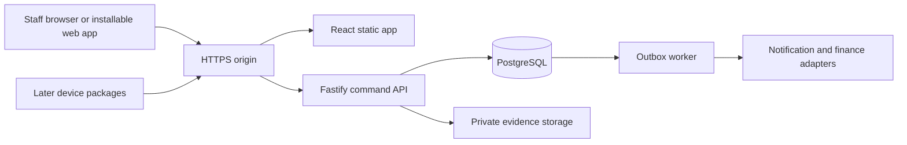

# VMMS system design

Status: accepted engineering baseline for implementation, 7 November 2026. Operational policies and production launch still require the decisions in the [review register](../decisions/review-register.md). The implementation must satisfy the [master specification](../sources/master.md), the user's greenfield override and the [historical-backlog requirement](historical-import.md).

## Chosen design

Use a React TypeScript browser application, a Fastify TypeScript command API, and PostgreSQL. Keep one backend deployment with domain modules and one canonical database. A separate worker process later delivers committed outbox messages. Private S3-compatible storage owns evidence objects. These are deployment units, not independently owned microservices.

Serve the browser and `/api/v1` behind one HTTPS origin at proposed `vmms.raymond-gray.org`. The development proxy reproduces that same-origin routing. The staff session is server-held; the browser receives an HttpOnly cookie and a CSRF token. Production identity, MFA, hosting and recovery targets remain launch gates.

## Caller contracts

The browser submits named commands such as create reception draft, add complaint and open hold. It supplies a command UUID and, for existing records, the last observed work-order version. It cannot post an actor, trusted organisation, approved privilege or gate result. The server derives identity and site membership and returns a scoped projection with the committed version and evidence requirements. The [aggregate command, event and outbox contract](aggregate-command-contract.md) defines the shared persistence boundary while leaving domain authorization and projections in their owning modules.

The [initial API contract](initial-api-contract.md) defines the first usable unit. Every later command requires an accepted contract and a linked task. Generate transport types from the eventual OpenAPI schema; until generation is wired, runtime boundary schemas and contract checks must guard the deliberately small initial contract. Do not export database row types as client types.

## Module ownership

| API module | Owns |
| --- | --- |
| Identity | People, staff accounts, sessions, organisation, site and active access membership |
| Authority | Named signed grants, validity, restrictions, revocation, approval snapshots and segregation |
| Reception | Canonical customers, vehicles, appointments, visits, custody and recovery |
| Owner access | Owner principals, site-scoped vehicle-access aggregates, relationship revisions, explicit approval grants and owner-safe access decisions |
| Workshop | Work orders, complaints, tasks, scope revisions, diagnostic findings, task progress and gate facts |
| Safety and quality | Scoped holds, permits, incidents, quarantine, independent inspections, tests and release |
| Materials | Parts, compatibility, procurement, receipts, lot/serial custody, reservations and movements |
| Commercial | Coverage, proposed/approved payer, costs, claims, invoices, receipts, credit and G5 |
| People and equipment | Skills/training evidence, supervision, assets, calibration, readiness and impact |
| Governance | Controlled revisions, effective instructions, acknowledgements, audits, CAPA and management action |
| Evidence | Upload intents, private object acceptance, hashes, scanning and scoped download/export |
| Delivery and audit | Command receipts, append-only events, durable outbox, worker leases and adapters |
| Reporting and import | Versioned metric projections; staged historical batches, source aliases and reconciliation |

Place server code in `apps/api`, client code in `apps/web`, deterministic checks in `scripts`, and project documents in `docs`. Start with actual modules needed by the first slice; do not create empty framework layers for future work. A normal request follows HTTP boundary, domain command and database transaction. Avoid pass-through controller/service/repository stacks.

## Invariants

Use UUIDs independently from readable references. One visit has one controlling work order, enforced by uniqueness. Allocate references through a transaction-safe sequence or locked counter. Complaint and task ordinals are unique within the work order. VIN identity is organisation-scoped and normalised; work belongs to a site. Cross-organisation references are prohibited by scoped constraints and application policy.

Record the five gates independently. Gate state can be pending, accepted, superseded or historically unknown. A draft is never an accepted gate. Tasks retain their own progress; a held task does not freeze unrelated tasks. A vehicle/work-order safety hold blocks technical release. Diagnostic permission is purpose-specific and never approves repair scope. A new scope revision requires the appropriate new approvals.

Roles control access to work areas. Named, signed grants control technical, inspection, release, governance and financial decisions. Check current validity and scope at action time. Lock grants during decisions and revocation using the same ordering. Store the exact grant revision and evidence in the decision snapshot. A high-level account role cannot bypass independence or safety.

Store monetary values as integer minor units with currency and a precision policy. Store quantities and time as bounded decimals. Separate warranty coverage, immediate approved payer, recovery claim and reconciled cash. Use UTC timestamps and a configured site timezone. Preserve inconclusive diagnosis and unknown historical approvals.

## Transaction protocol

1. Validate the boundary payload and authenticate current session/site access.
2. Begin a transaction and set transaction-local organisation/site context using the non-owner runtime database role.
3. Lock and recheck active membership, then evaluate current command authority before looking up a receipt.
4. Locate a matching receipt. Matching content returns its schema-validated original result; different content with the same key conflicts.
5. Lock the aggregate rows in a documented order. Work-order hold and release commands use the same work-order lock. Vehicle-wide operations additionally coordinate through the vehicle row.
6. Reject a stale expected version, then evaluate current scope, equipment, evidence and independent inspection requirements.
7. Write the domain change, new version, attributable event, receipt and outbox item atomically through the aggregate contract.
8. Commit before external delivery. A worker leases outbox rows and adapters provide their own idempotency.

Receipt identity is actor, organisation, site and command UUID. Hash operation, target and canonical payload. Unique constraints and transaction-safe retry handling must prove simultaneous key insertion does not duplicate work. Failed validation or transaction rollback produces no partial business change.

RLS is defence in depth. Use a runtime role that neither owns tables nor bypasses RLS, explicit `SET LOCAL` context, and tests for pooled connection reuse, direct SQL, workers and exports. Migration credentials are separate. Application checks remain required. The initial bootstrap must never claim RLS protection while running business queries as an owner role.

Audit and signed decisions deny update/delete to the runtime role. Corrections append a reasoned event. Database administrators remain a separate trust boundary; restricted operations and independent audit export belong in the production runbook.

## Evidence and drafts

An upload intent is not accepted evidence. Finalization checks object identity, checksum, size, permitted content, malware result and record scope. Only accepted private evidence can satisfy a gate. Access is short-lived and authorised per record. Object-store writes and SQL cannot be one transaction, so explicit pending, rejected and accepted states handle interrupted uploads. The [evidence storage design](evidence-storage.md) defines the stream, quarantine, scan-worker, access-audit and backup boundary.

Saved local drafts are account/site-bound proposals with visible storage state, retry command IDs and sign-out cleanup. Intake recovery is opt-in and tab-scoped; the current implementation expires data eight hours after its last save. That lifetime is a proposed shared-device policy pending owner review in [REV-026](../decisions/review-register.md). The service worker caches static assets only; it must not replay arbitrary API mutations. The [platform strategy](platform-strategy.md) governs later native and sync work.

## Synthesis decision

[Candidate A](candidates/a-django.md) offered Django's mature identity/migration support. [Candidate B](candidates/b-typescript.md) offered a dedicated TypeScript command API and shared contract tooling. The [independent review](candidates/judge.md) scored B 88 and A 87 against the weighted rubric. Both were viable. B is the base because one application language and a dedicated cross-device API reduce contract and tooling duplication for this new project.

Graft A's explicit grant/revocation serialization, replay-before-version check, transaction-local RLS context, private evidence acceptance states and safe shared-device draft defaults. Extend B's gate union with unknown and superseded states. Keep the user's external historical backlog as an explicit import workstream. Reject automatic interpretation of old completed labels as gate evidence.

Accept that the Node server requires deliberate session, migration, policy and worker implementation that Django would supply in part. Those costs remain named tasks and tests. Reject desktop-first multi-writer storage, generic HTTP replay, fire-and-forget dual writes, premature microservices and a promise that Android support establishes HarmonyOS support.

## Verification limits

The candidate documents describe a design, not completed tests. PostgreSQL integration tests must prove RLS, replay, rollback and races using the actual runtime role. Browser tests must exercise real persisted data, account/site switching, failure and draft recovery. Physical-device, restore, production identity, financial and technical authority checks remain open until their evidence is recorded.
