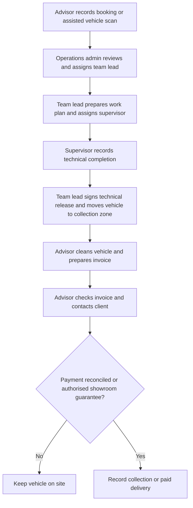

# Work-order lifecycle and booking identity

**Status:** Accepted user workflow baseline, 8 November 2026. Named staff, financial authority, warranty evidence, controlled SOP fields and hybrid routing still require configuration or owner review.

## Source and scope

The master functional specification remains the main requirements source. The owner supplied additional service-centre direction on 8 November 2026. This document records that direction and translates it into application boundaries. It does not approve operational privileges, financial limits, warranty coverage, external messaging or production use.

The service-advisor workbook inventory is in [service-advisor backlog inventory](../discovery/service-advisor-backlog-inventory.md). The workbook contains historical input only. It is not imported into the current work-order ledger.

## Business identities

Keep three identities separate on every booking:

| Identity | Meaning | Example |
| --- | --- | --- |
| Client | The party that pays or is invoiced for service. A client may be a person, showroom or other organisation. | EV Afriq Showroom |
| Vehicle owner | The person or organisation reported to own the vehicle. Record the relationship and its evidence state separately from the client. | The named owner, if supplied |
| Visit contact | The person staff deal with for this visit. The person may represent the client, the owner or another party. | The person presenting the vehicle |

The same party may hold more than one identity only when staff explicitly select that party for each role. A shared phone number, email address, VIN, name or client code never creates a link by itself. Intake supports an explicit site-scoped existing-client selector; vehicle owner and visit contact remain separately entered for each visit and are not implicitly linked to the client. A client record, owner report or visit contact does not grant vehicle-owner portal access. The owner-access workflow remains a separate, evidence-backed approval boundary.

Use one canonical organisation-scoped party registry for people and organisations. Store the client party on the booking, the visit contact on the visit and reported owner observations in an append-only, site-scoped history. Preserve legacy records as unknown where their role cannot be established. Restrict party search to records already associated with the selected site until cross-site visibility is approved under `REV-011`. The current implementation provides a site-scoped client search and explicit reuse, assigns a system-generated unique client code by default, and accepts an optional controlled code such as `SR`. It persists distinct client, owner and contact identities without inferring links. Full customer relationship history, owner verification and UAT remain open.

The API models selection explicitly:

```ts
type PartyKind = "person" | "organisation" | "unknown-legacy";
type PartySelection =
  | { kind: "existing"; partyId: string }
  | { kind: "new-person"; displayName: string; phone: string; email: string }
  | { kind: "new-organisation"; displayName: string; clientCode: string; phone: string; email: string };

type VisitContactSelection =
  | { kind: "same-person-as-client" }
  | { kind: "existing-person"; partyId: string }
  | { kind: "new-person"; displayName: string; phone: string; email: string };

type VehicleOwnerSelection =
  | { kind: "not-recorded" }
  | { kind: "same-party-as-client" }
  | { kind: "existing-party"; partyId: string }
  | { kind: "new-person"; displayName: string }
  | { kind: "new-organisation"; displayName: string };

type OpenBooking = {
  client: PartySelection;
  visitContact: VisitContactSelection;
  vehicleOwner: VehicleOwnerSelection;
  vehicle: { kind: "new"; vin: string; propulsionClass: "EV" | "HYB" | "ICE"; /* identity fields */ }
    | { kind: "existing"; vehicleId: string; propulsionClass: "EV" | "HYB" | "ICE" };
  warrantyAtBooking: "confirmed" | "not-confirmed" | "unknown";
};
```

The party registry and role separation are the selected design. A separate customer-account table plus a second contact identity table was rejected because one person could then have duplicate identities and conflicting contact data. The additive migration strategy and historical profile-snapshot safeguards from that alternative remain: preserve existing IDs, classify legacy identities as unknown, leave historical visit-contact roles empty when the source cannot prove them, and keep the profile history append-only. The role slots stay explicit instead of using a generic relation table that could duplicate the same meaning.

## Operational sequence

The system records each handoff as a distinct, attributable transition:



| Transition | Accountable workflow role | Required system meaning |
| --- | --- | --- |
| Review and initial assignment | Operations admin with an explicit assignment grant | Review the new booking and assign an eligible EV or ICE team lead. An application-wide administrator flag does not bypass other controls. |
| Work plan and handoff | Team lead | Prepare the work plan, then assign a named supervisor who is eligible for the required work. Record each assignment and handoff. |
| Technical completion | Assigned supervisor | Sign the work as completed after its technical evidence and task requirements are satisfied. This is G3, not final vehicle release. |
| Technical release | Team lead with an explicit release grant | Sign the final release to service after required independent checks and safety holds pass. Record the vehicle's move to the collection zone. This is G4, not permission to leave the site. |
| Commercial preparation | Service advisor within the configured finance workflow | Clean the vehicle, prepare an itemized invoice from recorded approved work and Finance-approved rates, independently check it, issue it, and send it to the verified client email through the approved sender. Keep it draft/unissuable until rates, tax, legal template and financial grants are approved. Do not treat a source cost estimate or warranty claim as an invoice or payment. |
| Collection or delivery | Service advisor with the required handover authority | VMMS does not collect payment or use a payment gateway at launch. An authorized staff member verifies an external payment, records its invoice allocation and evidence, then VMMS generates a receipt for the verified amount and sends it to the verified client email through the approved sender. A receipt is not generated for unverified funds. Alternatively, an authorized showroom guarantee is recorded separately with its evidence; it is not a payment or receipt. Block departure until reconciled payment or a valid authorized guarantee is present, and all technical and inspection gates pass. This is G5 commercial closure. |

### Assignment command contract

Operations assignment is a versioned staff command on the work-order aggregate, not an editable role field. Its payload names the selected team lead and records the confirmed vehicle class used for routing. The API derives actor, organisation and site from the authenticated session; it rejects any payload that attempts to supply those values. The command requires the current work-order version, a unique command ID, and a reason. A successful transaction appends the assignment event and outbox item with the work-order version change. Replaying the same command returns its original result; reusing its ID for different content conflicts.

Authorization is checked at action time against a current, active Operations assignment grant scoped to the organisation and site. The proposed lead must be an active staff member at that site with an effective qualification for the recorded class (`EV`, `ICE`, or the manually reviewed `HYB` route) and must not be suspended or outside the grant's effective dates. A display role or administrator flag is insufficient. Assignment history is append-only: reassignment requires a new authorized command and preserves the prior lead, actor, reason and time.

Until the signed authority schedule, staff identity/qualification evidence and membership are configured, the assignment command remains unavailable and fails closed. Do not seed operational grants or qualifications. The lead-to-supervisor handoff command is implemented as a separate versioned command: it requires the currently assigned lead, an active `work-order.handoff-supervisor` grant, and a qualified active site member for the work-order powertrain (`EV-SUPERVISOR`, `HYB-SUPERVISOR` or `ICE-SUPERVISOR`). The migration seeds none of these grants or qualifications. Its append-only history records the handoff note. The work-order page offers only the currently eligible site supervisors to an authorized lead and captures a text work-plan/handoff summary. PostgreSQL integration proves eligible-list visibility, a successful handoff, idempotent replay and denial to another staff member. Responsive browser smoke verifies the pre-assignment blocked state; it has not exercised the authorized lead form. A structured work-plan and task allocation model remain open, as do supervisor G3 completion, team-lead G4 release and their distinct acceptance tests; one transition never implies another.

Minimum PostgreSQL acceptance cases: deny missing/expired/revoked or wrong-site Operations grants; deny inactive, wrong-class, unqualified or wrong-site leads; allow a qualified EV or ICE assignment; require explicit Operations routing for HYB; reject stale work-order versions; replay an identical command once; reject changed-content key reuse; and preserve the old assignment on reassignment. Tests must run using the non-owner runtime role and prove atomic rollback of state, event, receipt and outbox on injected failure.

The application sets the resolved/completed timestamp from the supervisor's signed completion transition. Staff do not type this timestamp. Reopening or rework creates later transitions; it does not erase the prior completion event. The final-release and departure timestamps are separate.

An emergency safety action remains available without billing approval. A safety or quality hold blocks the affected release even when the client has paid or a showroom has guaranteed payment. Conversely, technical completion or release does not establish payment.

## Vehicle classification and booking reference

At booking creation, record a confirmed propulsion class: `EV`, `HYB` or `ICE`. A camera or VIN scan may prefill candidate values, but an advisor confirms the vehicle identity and class. The app must not infer the class from an unverified model string.

The requested human-readable reference is:

```text
<powertrain>-<client-code>-<client-sequence>[W]
```

For example, `EV-SR-00001W` means the first booking in the selected client sequence, using client code `SR`, with warranty confirmed at the point represented by the reference. The database stores the class, client party, sequence, warranty state and reference as separate fields. Reports and authorization checks read those fields, not parsed reference text.

Owner-confirmed implementation rules from 8 November 2026:

- Allocate the next number atomically per client across EV, hybrid and ICE bookings. Never reuse a committed number, including after cancellation.
- Store the client code on the client party as a unique, stable organisation-scoped code. `SR` is a configured code, not a value inferred from the client name.
- Include `W` only when the warranty state is confirmed at booking creation. Preserve the current warranty-coverage decision separately. A later coverage decision must not silently rewrite an issued reference.
- Use at least five digits and allow the sequence to grow beyond five digits rather than failing or reusing a reference.
- If the vehicle class is corrected after the reference is issued, retain the original reference and record the corrected class in history.

Operations assigns each hybrid job to a qualified lead and records the assignment (`REV-031`).

## Commercial and dispatch controls

The client party is the default invoiced party. Warranty coverage, goodwill, showroom guarantees and internal cost allocation remain separate records. Keep BR-07's separation between coverage and payer allocation.

The dispatch control checks all of the following on the server:

1. The team lead has signed G4 release, and no blocking safety or quality hold remains.
2. The invoice is generated from the work order and an authorised rate/tax configuration.
3. An authorised service-advisor or finance check records that the invoice is correct.
4. Either a reconciled payment covers the amount due, or a named authority has recorded a showroom guarantee with its covered amount, client, evidence, actor and time.
5. The requested handover mode is collection or a delivery service whose charge and acceptance are recorded.

Payment text, a screenshot, a warranty label, an unresolved receipt or a caller-provided guarantee is not sufficient on its own. The payment provider, reconciliation rules, guarantee authority and exact evidence requirements remain subject to `REV-012` and `REV-032`. Until these are configured, dispatch stays closed.

## Historical fields and excluded information

- Generate Raymond Gray booking references. Do not reuse or parse the service-advisor workbook's booking numbers.
- Do not add sales-representative or client-satisfaction fields to operational screens, business records or reports.
- Do not use the workbook's technician-assigned value as a current team-lead assignment, supervisor sign-off or authority grant.
- Keep source-reported status, completion date, warranty and cost data as historical claims with source provenance. Do not convert them into current G3/G4/G5 approvals, verified warranty coverage, invoices or reconciled payments.
- Keep complaint category and source severity as historical issue attributes. They do not become a safety hold without an explicit safety assessment.

## Pending owner review

The review register owns open business choices. The owner confirmed a client-wide sequence across powertrains, `W` only for warranty confirmed at booking creation, and manual qualified-lead assignment for hybrids. The unique client-code assignment convention is still pending under `REV-033`. The exact showroom-guarantee authority and evidence, warranty proof, finance limits, return-to-work rules, client-contact rules and controlled SOP-001 fields remain pending. Do not enable a blocked transition because an item has a recommendation.

## Verification contract

The current implementation slice has an additive `parties` registry, nullable legacy-compatible role links, a separately scoped owner-observation table, explicit intake fields, and a reported/unverified owner state. No historical rows are backfilled into inferred roles. Site-scoped client-party search and explicit reuse are implemented. The database allocates a serialized sequence per paying client across powertrains; generated booking snapshots retain the client code, sequence, class and warranty-at-creation state. `W` requires a confirmed state and a recorded basis note. Focused and full PostgreSQL API integration tests cover distinct party roles, site-local lookup, repeat bookings, immutable references and concurrent cross-powertrain allocation. The complete operations workflow, financial and warranty evidence policy, historical import, responsive browser verification and UAT remain open.

The implementation and UAT must prove that:

- Client, reported owner and visit contact can differ and remain separately visible in the booking and vehicle history.
- Selecting an organisation as client does not assign its contact person as owner or grant either party owner-portal access.
- Only the assigned supervisor can sign technical completion, and only an eligible team lead can sign G4 release.
- G3, G4, invoice review, payment/guarantee, handover and vehicle departure remain separate transitions with independent audit evidence.
- A blocking safety/quality hold cannot be bypassed by an admin role, client payment or showroom guarantee.
- The system-generated completion time comes from the signed transition and cannot be posted by the browser.
- Booking references are unique under concurrent intake, use the correct client sequence, preserve cancelled numbers, and never determine authority or warranty state.
- Vehicle departure fails closed when payment is unreconciled and no authorised guarantee is recorded.
- Historical free-text statuses and dates remain source claims until an approved import map assigns them.
