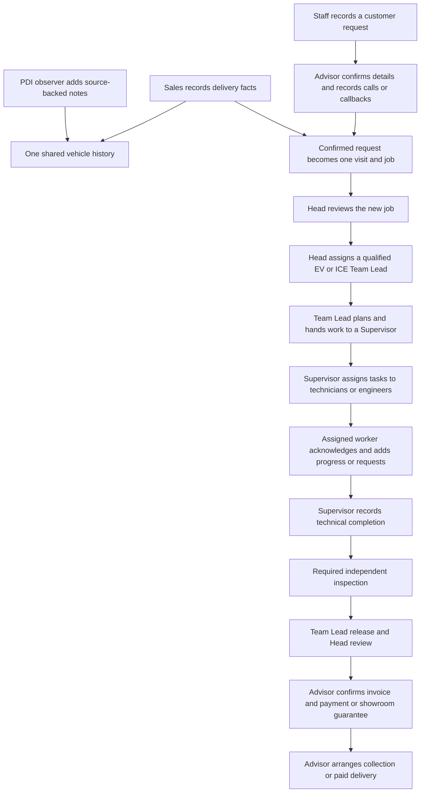

# How work moves through VMMS

This is the plain-language map of the service journey. Staff work starts from the left-hand workspace menu. Each record leads to the next step; a vehicle owner sees only the owner pages allowed for their verified vehicle access.

## What each area means

| Area | Who uses it | What it is for |
| --- | --- | --- |
| Sales and deliveries | Sales Representative; PDI Observer for PDI notes; same-site staff for history | Save the vehicle once, record delivery facts, and later add factual PDI observations. Purchaser-at-delivery does not set current owner or payer. |
| Requests and callbacks | Service Advisor and approved request handlers | Record who called, what they reported, what is known, who will respond, and when. A request by itself is not a repair job. |
| New intake | Service Advisor or approved reception role | Confirm the payer, owner, caller, vehicle, concern, and visit facts before creating the one visit and job. A saved draft is not customer consent or permission to repair. |
| Work orders | Workshop roles according to their access | Follow one job through review, assignment, work plan, tasks, evidence, holds, technical completion, release, payment, and handover. |
| My assigned tasks | Technician, Engineer, or Trainee | See work handed to the signed-in person, acknowledge the current assignment, and add progress, blockers, comments or requests. These updates do not complete the task or authorize work. |
| Head overview and People and roles | Head of Service Centre | Monitor site work, assign staff to existing roles, review queues and reports, and message staff. The Head does not perform Operator account administration by this title alone. |
| Staff accounts | VMMS Operator | Request and manage account lifecycle through shared sign-in. Operator access does not provide workshop, safety, inspection, release, or financial authority. |
| Documents | Staff with workspace access | Read current published procedures. Draft and unapproved procedures are not presented as effective instructions. |

## What is usable and what still needs work

- Request capture, caller details, callback tracking, conversion to one job, closing and reopening requests, and immutable contact/status history have API, PostgreSQL, and local-browser verification. Staff acceptance testing remains open.
- A request converted to a vehicle visit now keeps its reported caller, concern, vehicle, paying client, channel and callback plan beside the intake form. Staff confirm the actual payer, vehicle and visit contact; one job then enters Operations review. A local browser test covers response-loss retry and request/job linkage.
- Intake, one canonical work order, Operations review and team-lead assignment, supervisor handover, task allocation, and assigned-worker progress history are implemented in slices. A complete staff walkthrough from Sales through vehicle handover has not passed user acceptance testing.
- Sales delivery and PDI has a selected design and a first local implementation. Its current database/API checks pass; a full responsive browser check, role rehearsal, correction workflow review, and staff acceptance remain open. Do not promote workbook rows.
- Sales and PDI facts flow into one site-scoped vehicle history. When someone calls with a concern, the caller records a separate service request and follow-up; vehicle/client text on that request is only a reported claim until confirmed during reception.
- Technician progress updates, the approved technical completion and independent inspection rules, final release ordering, invoice and payment recording, and collection/delivery closure are not all complete. `REV-035` and `REV-046` keep unsafe or financially consequential sign-offs unavailable until the owner supplies approved rules.
- The current task feed records progress, blockers and requests, but it is not yet an attributable repair-action journal. The work-order summary is not yet a full Daily Service Report. That work is tracked in the [service work-history and report contract](../architecture/service-work-history-and-reports.md).

## Current report awaiting identity check

The 12 November 2026 EV after-sales report is prepared as a structured pending record in [the intake note](../operations/pending-report-2026-11-12.md). the source-report customer is confirmed as the paying client. The VIN differs from the sales workbook by one character; verify it on the physical vehicle or its documents before creating the canonical vehicle or job. No database job was created.

## Design rule

One staff screen should answer: **What am I responsible for now? What information is missing? What is the next allowed action?** If a screen asks staff to approve a procedure, decision, amount, or sign-off that has not been supplied and approved, that action stays unavailable and explains why.
